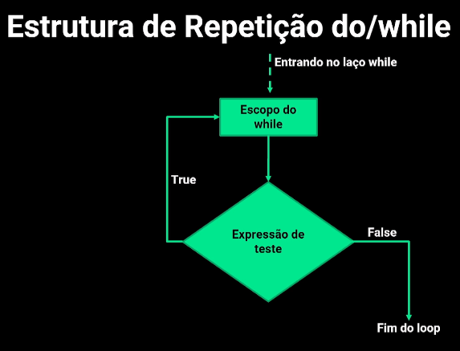
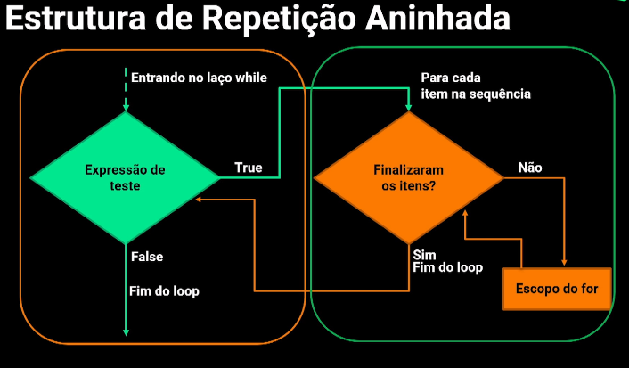

Metodos 

São blocos de códigos que executam uma tarefa específica.
Dividir um problema complexo em partes menores.

Em Java, exitem dois tipos de métodos:
- Métodos definidos pelo usuário
- Métodos de biblioteca padrão

Modificadores de acesso:
- Public 
- Private
- Protect